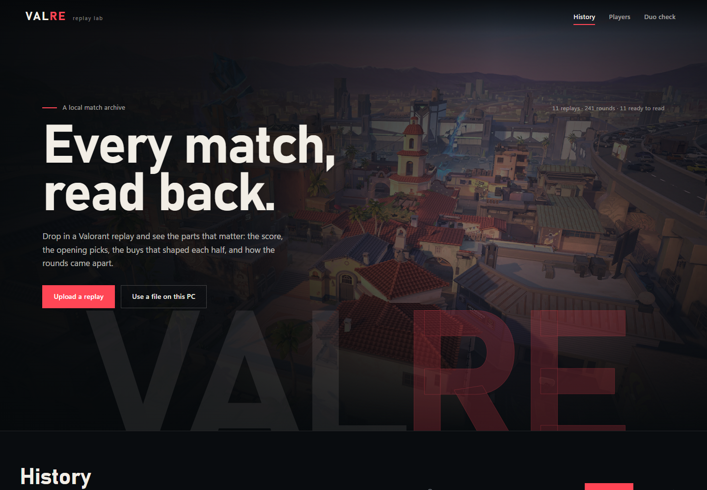

# VALRE

A local-first Valorant replay lab. Drop in a `.vrf` file and read the match back as a
tactical dossier: the score, the economy, opening duels, trades, aim, movement, and the
rounds that actually decided it.

Everything runs on your machine. Replays are parsed locally and the derived data stays on
disk. Network calls are limited to game metadata/icons and the optional AI and Riot ID
integrations you configure.



## What it does

- **History** — upload a `.vrf`, link one already on disk, name it, and rename it later.
- **Match** — final score, K/D/A, ACS, ADR, KAST, headshot share, first bloods, and the
  economy behind each half.
- **Rounds** — one panel per round with the winner, buy, spike events, first bloods,
  trades, clutches, and error rounds.
- **Map** — 2D playback of any round with player positions, facing, kills, the game's own
  callout regions, and movement heatmaps.
- **Aim** — shots, sprays, hit locations, and proxy duel metrics: pre-aim, head level,
  reaction, time to damage, counter-strafing, and spray control.
- **Coach** — a six-axis power profile, letter grades, and a practice prescription.
- **Judge** — a round-by-round verdict on the economy decisions that changed the match.
- **Ask AI** — natural-language questions over a compact match dossier, using any
  OpenAI-compatible endpoint.
- **Players** — cross-replay profiles with match history, attack/defence splits, weapons,
  and aim summaries.
- **Duo check** — how a pair performs together, including trades, opening duels, and how
  far apart they were when one died untraded.
- **Full stats / Tables** — the complete sortable stat tables and a browser for all 13
  exported Parquet tables.

## Requirements

- Windows 10/11 for the launcher scripts (the server and UI run elsewhere with the manual
  steps below)
- Python 3.12+
- Node.js 20+
- [vrfkit](https://github.com/yakisoba0728/vrfkit) v0.3.0, Windows release

## Setup

```powershell
git clone https://github.com/ni8x/valre.git
cd valre

# 1. Put vrfkit.exe in .\bin\
#    Download it from https://github.com/yakisoba0728/vrfkit/releases

# 2. Python dependencies
python -m pip install -r server\requirements.txt

# 3. Build the frontend once
cd web
npm ci
npm run build
cd ..

# 4. Start the app
python server\app.py
```

Open <http://127.0.0.1:8000>.

On Windows, `.\run.ps1` (or `run.bat`) performs steps 2-4 and opens the browser. It expects
`bin\vrfkit.exe` to already exist.

### First match

1. On **History**, choose **Upload a replay** or **Use a file on this PC**.
2. Give the replay a name. The name is stored locally and can be changed later from the
   match header with **Rename**.
3. Wait for the export to finish, then open the match.
4. If agent and map icons are missing, choose **Sync game icons** on the History page.

Player labels are local too. Open a player from **Players** to give a subject GUID a
readable name; that name then appears across matches and pair views.

## Tests

```powershell
python -m pytest -q
```

The engine tests run against the Parquet exports in `data/replays/`. Tests that need a real
reference replay skip themselves when that export is absent, so a fresh clone still runs the
pure-function tests. This repository deliberately does not include replay files or the
third-party reference report used during development.

## How it works

```
.vrf
  └─ vrfkit export ──> 13 Parquet tables
       └─ server/stats.py, metrics.py, spatial.py, coach.py, duo.py
            └─ FastAPI JSON API
                 └─ React + Vite interface
```

- `server/vrfkit.py` runs the export and caches progress.
- `server/stats.py` rebuilds rounds, economy, trades, openings, and per-player totals.
- `server/metrics.py` and `server/engagement.py` produce shot and aim measurements.
- `server/spatial.py` and `server/regions.py` build map tracks, heatmaps, and callouts.
- `server/coach.py` and `server/judge.py` turn the match into grades and a prescription.
- `web/src` is the React app; the server serves the built files from `web/dist`.

## Caveats

- `.vrf` data does not contain Riot IDs. Players are identified by subject GUID and the
  names shown are local labels, not Riot accounts.
- Replays carry no visibility data. Aim and duel metrics are geometric proxies and are
  marked as such in the interface.
- Ability casts are captured from a rolling per-round window, so cast history is partial.
- Derived stats are reconstructed from the packet stream. Damage, kills, and score are
  cross-checked, but the numbers remain best-effort rather than an official Riot feed.

## Privacy and AI

Uploaded replays, exports, and labels stay under `data/` and `replays/`; neither directory
is tracked by git. There is no telemetry or account system.

Duo check can optionally tag a Riot ID through Riot's API when `RIOT_API_KEY` is set.
Without a key, the local evidence picker works offline.

The **Ask AI** tab sends a match dossier to the endpoint configured through:

```
AI_BASE_URL   # default: http://127.0.0.1:31415/v1
AI_API_KEY
AI_MODEL      # default: auto
```

Point these at a local model (for example Ollama at `http://127.0.0.1:11434/v1`) if you want
the conversation to stay entirely offline.

## Credits

- [vrfkit](https://github.com/yakisoba0728/vrfkit) for replay parsing and export.
- [valorant-api.com](https://valorant-api.com) for agent, map, and ability metadata.
- VALORANT is a trademark of Riot Games. This project is not affiliated with or endorsed
  by Riot Games.

## License

Copyright (C) 2026 ni8x.

This program is free software: you can redistribute it and/or modify it under the terms of
the GNU General Public License as published by the Free Software Foundation, either version
3 of the License, or (at your option) any later version.

This program is distributed in the hope that it will be useful, but WITHOUT ANY WARRANTY;
without even the implied warranty of MERCHANTABILITY or FITNESS FOR A PARTICULAR PURPOSE.
See the GNU General Public License for more details.

You should have received a copy of the GNU General Public License along with this program.
If not, see <https://www.gnu.org/licenses/>.

